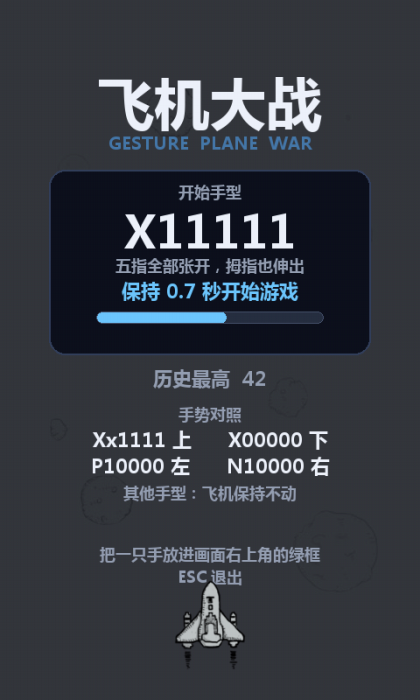
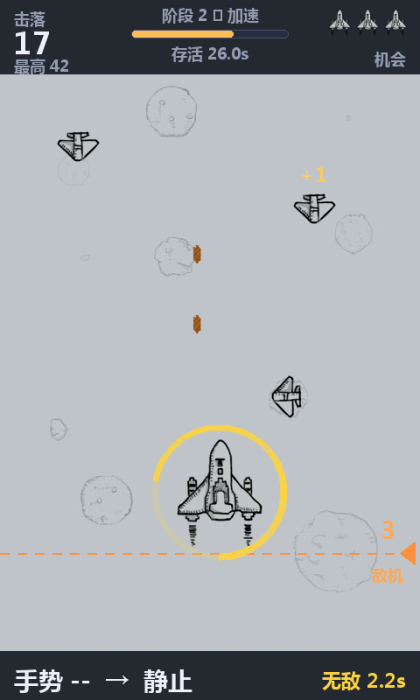
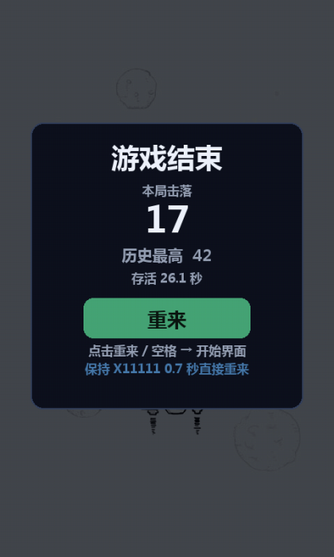

# 基于 MediaPipe 手势识别的打飞机小游戏

在 pygame“打飞机”玩法的基础上，用手势控制飞机、自动射击。手势识别使用
**MediaPipe Hands**，并且与同工作区的双手手势音游（`Hand-gesture-ps-game`）
使用几乎完全相同的判断逻辑：只看**一只手的 21 个关键点**，用关节夹角判断手指
伸缩、用拇指朝向判断左右。

- 游戏窗口：480×800 的画面按 87.5% 显示为 **420×700**（与手势音游的游戏窗口一致）
- 识别区域：摄像头画面**右上角 1/4**，再取该区域的 **95%**
- 开始 / 重来：手型 **`X11111`（五指全部张开）保持 0.7 秒**



## 手势映射

一只手写成 6 个字符：`[P|N] + 拇指、食指、中指、无名指、小指（1 张开 / 0 收起）`。
本项目采用手势音游中**画面右边那只手**的约定：`P` = 拇指朝左，`N` = 拇指朝右。

| 手型 | 含义 | 飞机动作 |
| --- | --- | --- |
| `X11111` | 五指全部张开（X 为 P 或 N） | 保持 0.7 秒开始 / 重来 |
| `Xx1111` | 四个长手指张开，拇指伸出或收拢 | 向上 |
| `X00000` | 握拳（拇指收起） | 向下 |
| `P10000` | 只伸出拇指且朝左 | 向左 |
| `N10000` | 只伸出拇指且朝右 | 向右 |
| 其他手型 / 没有手 | — | 保持不动 |

其中 `X` 表示 `P` 或 `N` 均可，`x` 表示 `1` 或 `0` 均可。注意开始姿势要求
**拇指也伸出**（`X11111`）；拇指收起的 `Xx1111` 只让飞机向上，不会开始游戏。

手指伸缩由 `MCP → PIP → DIP → TIP` 的三维关节夹角判断（PIP ≥ 158°、DIP ≥ 140°
视为伸直）；拇指张开由“IP 夹角 + 指尖到掌心距离 + 是否向掌心弯曲”共同判断。
连续帧再做逐字符多数投票，避免抖动。

## 玩法



- 玩家飞机可持续移动、自动开火；敌机不断生成。
- 共 **3 次机会**。飞机撞到敌机损失一次机会，并获得 **3 秒无敌时间**：无敌期间
  飞机闪烁，周围有黄色圆环以“加载动画”的方式显示剩余无敌时间。
- 3 次机会用尽即结束，结算界面显示本局击落数、历史最高分和**重来**按钮。
  重来可以点击按钮 / 按空格回到开始界面，也可以直接保持 `X11111` 0.7 秒再开一局。
- 碰撞箱为圆形且缩小：玩家飞机的碰撞圆半径 25.5 px（机翼总宽 102 px，圆只覆盖
  一半机翼），敌机半径 14.25 px。

### 难度模型

难度由三个量控制，分两个 20 秒阶段推进，40 秒后保持不变：

| 量 | 含义 | 0–20 s | 20–40 s | 40 s 之后 |
| --- | --- | --- | --- | --- |
| A | 顶部敌机生成间隔 | 1.5 → 1.0 s（每次 ±0.2 s） | 1.0 → 0.8 s（±0.2 s） | 0.8 s（±0.2 s） |
| B | 敌机下落速度 | 120 → 150 px/s（每架 ±20） | 150 → 190 px/s（±20） | 190 px/s（±20） |
| C | 侧边敌机生成间隔 | 8 s（±1.5 s） | 8 → 6 s（±1.0 s） | 6 s（±1.0 s） |

每架敌机的速度都独立随机赋值。**侧边敌机**是新机制：每隔 C 秒安排一架横向飞行的
敌机，速度很低（55 px/s）；进入画面前 **3 秒**在画面边缘用箭头、倒计时数字和横向
虚线标出它驶入的位置和高度；若生成时刻玩家飞机靠近画面左侧，它从**右侧**驶入，
否则从左侧驶入。



## 运行

首次安装（会创建 `.venv` 并安装 MediaPipe 依赖）：

```bat
setup_env.bat
```

之后每次使用：

```bat
:: 1. 检查摄像头（会自动请求管理员权限，UAC 选择“是”）
check_camera.bat

:: 2. 启动游戏（会自动请求管理员权限，UAC 选择“是”）
run_game.bat
```

游戏优先使用摄像头；没有可用摄像头时自动进入键盘模式（方向键移动，空格开始 /
重来），并用 `GAME_CAMERA=virtual` 强制键盘模式、用 `GAME_NO_ELEVATE=1` 跳过提权。
有摄像头时也可以用方向键辅助移动，但开始游戏必须做 `X11111` 手势。

环境自检与测试：

```bat
.venv\Scripts\python.exe verify_environment.py
.venv\Scripts\python.exe test_gesture_logic.py
.venv\Scripts\python.exe test_game_logic.py
.venv\Scripts\python.exe capture_game.py
```

`capture_game.py` 用无窗口的 SDL 驱动跑完整游戏循环并重新生成 `docs/` 下的截图。

## 代码结构

| 文件 | 作用 |
| --- | --- |
| [plane_game.py](plane_game.py) | pygame 场景（开始 / 游戏 / 结算）、主循环、摄像头预览标注 |
| [game_core.py](game_core.py) | 纯游戏逻辑：难度、生成、碰撞、机会与无敌、最高分（无 pygame/摄像头依赖） |
| [gesture_single.py](gesture_single.py) | 单只手的 MediaPipe 识别、ROI 裁切、骨骼绘制、后台摄像头线程 |
| [gesture_code.py](gesture_code.py) | 手势编码（`P11111` 等）、方向映射、开始手型判断 |
| [camera_compat.py](camera_compat.py) | 摄像头探测与无摄像头时的虚拟摄像头回退 |
| [check_camera.py](check_camera.py) | 摄像头自检与截图（`check_camera.bat`） |
| [verify_environment.py](verify_environment.py) | 环境自检 |
| [test_gesture_logic.py](test_gesture_logic.py) | 手势分类 / 映射 / ROI 单元测试（合成关键点，无需摄像头） |
| [test_game_logic.py](test_game_logic.py) | 游戏逻辑单元测试（难度、机会、无敌、碰撞、侧边敌机、最高分） |
| [capture_game.py](capture_game.py) | 无窗口运行游戏并生成 `docs/` 截图 |

## 文档

- `工作汇报.md`（位于工作区根目录）—— 本次改造的完整说明与验证记录
- [修改报告.md](修改报告.md) —— 早期“PaddleX → MediaPipe”替换记录（历史文档）
- [环境配置报告.md](环境配置报告.md) —— 早期 PaddleX 版本的环境配置记录（历史文档）

## 原项目

- 演示视频：https://www.bilibili.com/video/BV1HV411t7LG/
- 原仓库：https://github.com/Sharpiless/Hand-gesture-recognition-for-game
