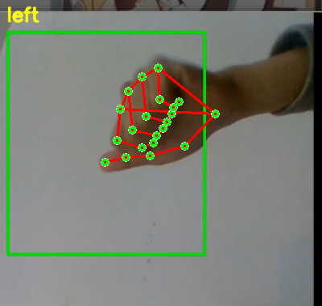
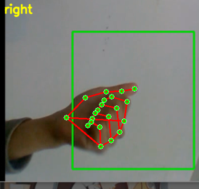

# MediaPipe 手势识别替换报告

> **历史文档说明**：本报告记录的是 2026-11-15 把 PaddleX 分类模型替换为
> MediaPipe Hands 的那次改动。其后的改造把识别改成**单只手**（识别区为画面右上角
> 1/4 的 95%），并按新规则重写了游戏逻辑，因此本报告中的 `gesture_mediapipe.py`、
> `plane_cnn.py` 已被 `gesture_single.py`、`gesture_code.py`、`game_core.py`、
> `plane_game.py` 取代，识别阈值也与本文不同。当前实现见工作区根目录的
> `工作汇报.md` 与 [README.md](README.md)。

- **项目**：Hand-gesture-recognition-for-game
- **修改日期**：2026-11-15
- **基线提交**：`7783d66 chore: configure game environment, camera startup, and docs`
- **修改目标**：用 MediaPipe Hands 替换原 PaddleX 图像分类手势识别；保留摄像头绿框单只手识别，并绘制骨骼点与连边。

---

## 一、修改背景

原手势识别使用 `rec_inference_model/` 中的 PaddleX MobileNetV3_small_ssld 分类模型。
模型在自身验证集上的 acc1 为 91.61%，但实际游戏中的准确率明显偏低，主要原因是：

- 训练数据与当前摄像头存在域偏移（光照、背景、距离、手的角度、镜像）；
- 模型只做整块 ROI 分类，没有手部关键点，无法稳定区分“点赞的方向”；
- 原推理每 10 帧才执行一次，低置信度结果会直接改变飞机方向。

因此本次改为 **MediaPipe Hands 关键点 + 几何规则** 识别，并直接在绿框 ROI 上绘制骨骼。

---

## 二、识别方案

### 2.1 输入与范围

- 只处理 `plane_cnn.py` 中摄像头画面的绿色手势框（`roi`）。
- 只识别 **1 只手**：`mp.solutions.hands.Hands(max_num_hands=1, ...)`。
- 摄像头画面在进入 ROI 之前已经被 `cv2.flip(frame, 1)` 水平镜像，所以识别结果中的
  左/右与玩家在预览窗口中看到的方向一致。

### 2.2 关键点与手指状态

MediaPipe 返回 21 个手部关键点，使用以下索引：

| 部位 | 关键点 |
| --- | --- |
| 手腕 | 0 |
| 拇指 | 2（MCP）、3（IP）、4（TIP） |
| 食指 | 5、6、8 |
| 中指 | 9、10、12 |
| 无名指 | 13、14、16 |
| 小指 | 17、18、20 |

- **手掌心**：取 0、5、9、13、17 的平均坐标。
- **手掌大小**：手腕 0 到中指 MCP 9 的距离。
- **手指折叠判据（本次更新）**：不再用“末端到手掌心距离”，改为判断 PIP 关节是否折叠。
  对每个长手指计算 `MCP → PIP → TIP` 的夹角：

  ```text
  angle(MCP, PIP, TIP) > 150°  -> 手指伸直（open）
  angle(MCP, PIP, TIP) <= 150° -> 手指折叠（folded）
  ```

  四个长手指（食指、中指、无名指、小指）分别统计，得到 `open_count`。
  握拳时指尖可能离手掌心仍然较远，单用距离会把手指误判为张开；改用 PIP 关节角后，
  只要手指弯回来就会被判为折叠，握拳灵敏度明显提高。
- **拇指张开判据**：

  ```text
  angle(拇指 MCP 2, 拇指 IP 3, 拇指 TIP 4) > 150°
  且 dist(拇指末端 4, 手掌心) > 0.75 × 手掌大小
  ```

  第二个条件用于排除“拇指伸直但贴在手掌上”的情况，避免误判成左/右。

- **拇指方向**：

  ```text
  dx = 拇指末端.x - 拇指 MCP.x
  dy = 拇指末端.y - 拇指 MCP.y
  sideways = |dx| > 0.80 × |dy| 且 |dx| > 0.25 × 手掌大小
  ```

### 2.3 手势判定顺序

```text
1. 拇指张开、四个长手指全部收缩、拇指横向：
       dx < 0 -> left
       dx > 0 -> right
2. 四个长手指中至少 3 个张开 -> up（手掌张开）
3. 四个长手指全部收缩、拇指未张开 -> down（握拳）
4. 其他情况 -> pause（静止）
```

> 竖直的点赞（拇指朝上）不属于左/右，会落到 `pause`，符合“其他手势静止不动”。

### 2.4 平滑

为避免关键点抖动导致飞机方向反复切换，识别结果进入长度为 5 的队列，
取出现至少 2 次的结果作为稳定输出；不足 3 帧时直接返回当前结果。

### 2.5 骨骼绘制

使用 `mediapipe.solutions.drawing_utils.draw_landmarks` 在 **ROI 上原地绘制**：

- 21 个关键点：绿色圆点；
- 手部连边：红色线；
- ROI 左上角显示当前识别标签（`up/down/left/right/pause`）。

由于 ROI 是 `frame` 的切片视图，绘制结果会直接出现在 `cv2.imshow('frame', frame)`
的摄像头预览窗口中。

---

## 三、代码改动

| 文件 | 改动 |
| --- | --- |
| `gesture_mediapipe.py` | **新增**。MediaPipe Hands 封装、几何分类、平滑、骨骼绘制 |
| `plane_cnn.py` | 删除 `paddlex.deploy.Predictor` 与 Paddle 模型加载；改用 `GestureRecognizer`；每次摄像头读帧都识别并绘制 |
| `verify_environment.py` | 改为检查 MediaPipe、手势模型和手势管线，不再检查 Paddle |
| `requirements.txt` | 移除 Paddle/PaddleX/PyYAML/setuptools；加入 MediaPipe 运行依赖 |
| `requirements-mediapipe.txt` | **新增**。只包含 `mediapipe==0.10.21`，由 `setup_env.bat` 用 `--no-deps` 安装 |
| `setup_env.bat` | 增加第 4 步：安装 MediaPipe（避免引入 jax/jaxlib 和 opencv-contrib） |
| `test_gesture_logic.py` | **新增**。8 组合成关键点的手指/拳头/方向分类测试 |
| `mediapipe_left.png` / `mediapipe_right.png` | **新增**。MediaPipe 骨骼与 left/right 识别结果截图 |
| `paddlex/` | **删除**。不再使用的 PaddleX 兼容层 |
| `README.md` | 改为 MediaPipe 版本说明 |
| `环境配置报告.md` | 保留为历史文档，并在开头标注手势识别已被 MediaPipe 替换 |

### 游戏内调用变化

原代码：

```python
pred = model.predict(roi)
move = pred[0]['category']
```

新代码：

```python
move = gesture.recognize(roi)   # 内部完成识别 + 骨骼绘制
if move != last_move:
    print('-[INFO] Update movement to ', move)
    last_move = move
```

识别在每次摄像头读帧时执行（游戏约 10 FPS 的预览频率），不再每 10 帧才更新一次。

---

## 四、依赖说明

本次选择 **MediaPipe 0.10.21**（`cp312-win_amd64`，Windows / Python 3.12）。

MediaPipe 的 PyPI 元数据会声明 `jax`、`jaxlib` 和 `opencv-contrib-python`，但本游戏只使用
`mp.solutions.hands` 的旧版 Hand Landmarker，不需要 jax，也不需要替换现有的
`opencv-python`。因此安装方式为：

```bat
.venv\Scripts\python.exe -m pip install -r requirements.txt
.venv\Scripts\python.exe -m pip install --no-deps -r requirements-mediapipe.txt
```

`requirements.txt` 中已包含 MediaPipe 实际需要的运行依赖：
`matplotlib`（`drawing_utils` 导入）、`protobuf 4.25.3`、`absl-py`、`attrs`、
`flatbuffers`、`sounddevice`、`sentencepiece`。

---

## 五、验证结果

### 5.1 分类逻辑单元测试

`test_gesture_logic.py` 使用合成 21 点坐标，不依赖摄像头：

```text
[PASS] open palm          expected=up    got=up
[PASS] fist               expected=down  got=down
[PASS] fist, thumb across expected=down  got=down
[PASS] thumb left         expected=left  got=left
[PASS] thumb right        expected=right got=right
[PASS] thumb up (other)   expected=pause got=pause
[PASS] point (other)      expected=pause got=pause
[PASS] peace (other)      expected=pause got=pause
RESULT: all passed
```

### 5.2 MediaPipe 真实关键点测试

使用 `demo.png` 中摄像头区域的手势图作为输入：

- MediaPipe 成功检测到 21 个关键点并绘制骨骼；
- 原图（拇指竖直向上）识别为 `pause`，符合“其他手势静止”；
- 将图片逆时针旋转 90°（拇指向左），识别为 `left`；
- 将图片顺时针旋转 90°（拇指向右），识别为 `right`。





### 5.3 游戏内集成测试

用一段包含手势的测试视频模拟摄像头，按游戏实际逻辑
（`imutils.resize` → `cv2.flip` → 固定 ROI 裁剪）送入游戏，日志输出：

```text
[INFO] Video source opened: <临时手势测试视频>
-[INFO] Update movement to  right
```

（测试视频为临时文件，验证后已删除。）

说明 **摄像头帧 → 镜像 → 绿框 ROI → MediaPipe → 方向输出** 的链路已打通，
骨骼也会绘制在同一 ROI 上。

### 5.4 环境自检

```text
[PASS] load MediaPipe Hands - 0.01s
[PASS] run gesture pipeline - no hand -> 'pause', 40.2 ms/frame
...
RESULT: all 20 checks passed.
```

### 5.5 性能

在 380×400 的手部图上，MediaPipe 稳定推理约 **14.2 ms/帧**；游戏 ROI 为
220×195，实际开销更小。按游戏 10 FPS 的识别频率，不会明显拖慢主循环。

---

## 六、运行方式

```bat
:: 1. 摄像头自检（自动请求管理员权限）
check_camera.bat

:: 2. 启动游戏（自动请求管理员权限）
run_game.bat
```

无摄像头或只想用键盘时：

```bat
set GAME_NO_ELEVATE=1
set GAME_CAMERA=virtual
run_game.bat
```

游戏内操作：

| 手势 | 动作 |
| --- | --- |
| 手掌张开 | 向上 |
| 握拳 | 向下 |
| 点赞，拇指朝左 | 向左 |
| 点赞，拇指朝右 | 向右 |
| 其他手势 / 没有手 | 静止 |

---

## 七、已知限制与调参

1. **单手、固定 ROI**：手需要基本落在绿框内；手出框会导致关键点缺失。
2. **角度阈值**：`gesture_mediapipe.py` 顶部集中定义了
   `FOLD_ANGLE`、`THUMB_OPEN_ANGLE`、`THUMB_DIST_RATIO`、`HORIZONTAL_RATIO`、`HORIZONTAL_MIN`，
   在不同手型/摄像头下可微调。
3. **平滑延迟**：5 帧滑动窗口会带来约 0.2–0.5 秒的稳定延迟；如果需要更灵敏，
   可减小 `smooth_window` 或减少“至少 2 次”的门槛。
4. **旧模型保留**：`rec_inference_model/` 仍保留在仓库中作为历史资料，但游戏已不再加载；
   原 `paddlex/` 兼容层已删除。
5. **摄像头权限**：非管理员桌面进程访问摄像头仍可能被 Windows 拒绝，
   `run_game.bat` / `check_camera.bat` 会自动请求管理员权限。

---

## 八、Git 记录

- 修改前基线提交：`7783d66 chore: configure game environment, camera startup, and docs`
- 本次 MediaPipe 修改提交：`feat: replace PaddleX gesture recognition with MediaPipe Hands`
  （提交哈希以 `git log` 为准）
