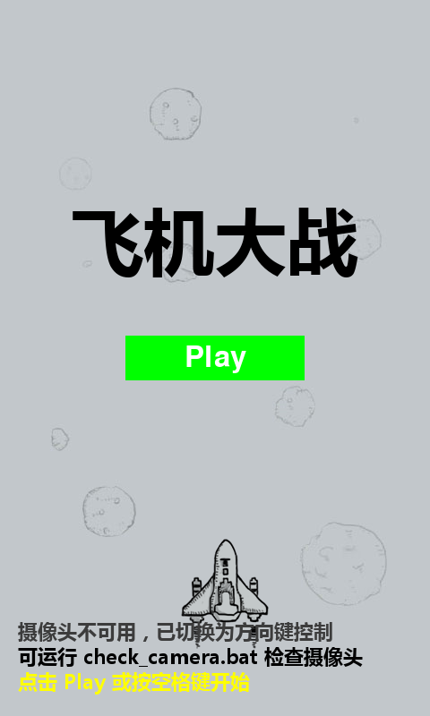
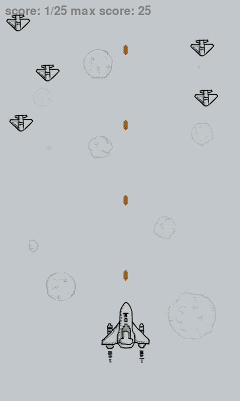

# 基于 PaddleX 的手势识别打飞机游戏——环境配置报告

- **项目目录**：`C:\Users\33260\Desktop\game\Hand-gesture-recognition-for-game`
- **配置日期**：2026-11-15
- **目标平台**：Windows 11 25H2（Build 26200.9711）/ Python 3.12.4 64 位
- **运行方式**：双击 `check_camera.bat` 检查摄像头，再双击 `run_game.bat` 启动（两个脚本都会自动请求管理员权限）

> **修正说明**
>
> 上一版报告曾把本机误判为“没有摄像头”。复查后确认：本机实际有 **2 个 UVC 摄像头**（FHD 彩色 + IR 红外），驱动状态均为 Started。误判原因有两个：
>
> 1. `Get-PnpDevice -Class Camera` 在当前权限下返回空，但 `pnputil` 和 Windows WinRT 都能正常枚举到设备；
> 2. 当前代理进程运行在 **Low 完整性级别**，Windows 相机接口对它的请求返回 `0x80070005 拒绝访问`，导致 `cv2.VideoCapture` 在 0–5 号索引上全部失败。
>
> 本版已修正代码：游戏默认自动扫描并优先使用摄像头；同时提供 `check_camera.bat`，用于完成真实的摄像头出图验证。
>
> **最终结果：摄像头已实际验证可用，游戏端到端验证通过。** 非管理员桌面进程访问相机时会被 Windows 拒绝（`0x80070005`），以管理员身份运行 `check_camera.bat` 后成功生成 `camera_snapshot.png`；双击 `run_game.bat` 并在 UAC 选择“是”后，游戏出现 OpenCV 摄像头预览窗口，手势可以控制飞机。因此 `run_game.bat` 和 `check_camera.bat` 都改成了自动请求管理员权限。

---

## 一、项目简介

本项目是一个用 Python + pygame 实现的“打飞机”小游戏。游戏通过摄像头采集手势画面，截取画面中的手势区域，送入 PaddleX 导出的图像分类模型，识别 5 种手势并控制飞机移动。

| 类别 ID | 标签 | 含义 |
| --- | --- | --- |
| 0 | `pause` | 暂停 / 不移动 |
| 1 | `down` | 向下 |
| 2 | `left` | 向左 |
| 3 | `right` | 向右 |
| 4 | `up` | 向上 |

模型文件位于 `rec_inference_model/`：

| 项目 | 内容 |
| --- | --- |
| 网络结构 | MobileNetV3_small_ssld |
| 任务类型 | 图像分类（classifier） |
| 输入尺寸 | 3 × 224 × 224（RGB） |
| 类别数 | 5 |
| 验证集 acc1 | 91.61% |
| 部署文件 | `__model__`（584 KB）、`__params__`（4.6 MB）、`model.yml` |

原始入口为：

```bat
python plane_cnn.py
```

---

## 二、目标机器环境检测

| 检查项 | 检测结果 |
| --- | --- |
| 操作系统 | Windows 11 25H2，Build 26200.9711（64 位） |
| CPU | Intel Core Ultra 7 155H（22 个逻辑处理器） |
| 内存 | 31.5 GB（可用约 15.4 GB） |
| 显卡 | Intel Arc 集成显卡，无 NVIDIA / CUDA |
| 摄像头 | **USB2.0 FHD UVC WebCam（彩色）+ USB2.0 IR UVC WebCam（红外）**，状态 Started |
| Python | 3.12.4（64 位），路径 `C:\Programme\Python\python.exe` |
| 磁盘 | C: 剩余约 140 GB |
| 显示 | 1440 × 810（远程桌面环境） |
| 相机权限 | HKLM / HKCU 的 `ConsentStore\webcam\Value = Allow`，无组策略限制 |

### 2.1 摄像头设备详情

`pnputil /enum-devices /class Camera` 的结果：

| 设备 | 实例 ID | 状态 | 驱动 |
| --- | --- | --- | --- |
| USB2.0 IR UVC WebCam | `USB\VID_3277&PID_0060&MI_02\...` | Started | usbvideo.inf |
| USB2.0 FHD UVC WebCam | `USB\VID_3277&PID_0060&MI_00\...` | Started | usbvideo.inf |

Windows WinRT 的 `DeviceInformation.FindAllAsync(DeviceClass.VideoCapture)` 返回 1 个可用的视频采集设备：

```text
USB2.0 FHD UVC WebCam | enabled=True
\\?\USB#VID_3277&PID_0060&MI_00#...#{e5323777-f976-4f5b-9b55-b94699c46e44}\GLOBAL
```

说明摄像头硬件、USB 枚举、驱动和系统相机权限都正常。

### 2.2 权限问题与最终验证

摄像头本身正常，但 **非管理员桌面进程访问相机时被 Windows 拒绝**：

| 测试方式 | 结果 |
| --- | --- |
| 代理进程（Low Mandatory Level，`S-1-16-4096`） | `cv2.VideoCapture(0..5)` 全部失败；`MediaCapture.InitializeAsync()` 返回 `0x80070005` |
| 非管理员权限直接运行 `check_camera.py` | OpenCV 无法打开 0–5 号摄像头 |
| **右键“以管理员身份运行” `check_camera.bat`** | **成功打开摄像头，生成 `camera_snapshot.png`** |

`SharedReadOnly` 共享模式同样返回 `0x80070005`，可排除“被其他程序独占”。同一台机器上 Edge、`lkdemo.exe`、`opencv_interactive-calibration.exe`、腾讯会议等程序都有过相机使用记录。

结论：**摄像头硬件、驱动、系统相机权限和采集链路都正常；限制来自 Windows 对非管理员/未打包桌面程序的相机访问控制。** 因此启动脚本改为自动请求管理员权限；如果希望免管理员运行，可在“设置 → 隐私和安全性 → 相机”中确认“让桌面应用访问你的摄像头”已打开。

---

## 三、依赖分析与版本选型

### 3.1 原始依赖

`pygame`、`opencv-python`、`imutils`、`paddlex`（1.x 部署 API）、`paddlepaddle`。其中 `paddlex.deploy.Predictor` 是 PaddleX 1.3.x 的接口。

### 3.2 兼容性问题

| 问题 | 说明 |
| --- | --- |
| PaddleX 1.3.1 过旧 | 发布于 2021 年，依赖 `paddle.fluid` 旧接口，官方未提供 Python 3.12 支持 |
| PaddlePaddle 3.x API 变化 | 旧版 PaddleX 部署代码与 Paddle 3.x 不兼容，旧静态图模型加载方式发生变化 |
| 全局 numpy 版本过高 | 机器全局 numpy 为 2.2.1，而 PaddlePaddle 2.6 要求 `numpy < 2` |
| 全局环境混杂 | 全局已安装 PaddleX 3.7.2，与旧模型部署 API 不同，直接复用会冲突 |

### 3.3 最终选型

| 组件 | 版本 | 用途 |
| --- | --- | --- |
| Python | 3.12.4 | 虚拟环境解释器 |
| numpy | 1.26.4 | 数值计算，满足 Paddle 2.6 的 `<2` 约束 |
| opencv-python | 4.10.0.84 | 摄像头采集、图像缩放、绘图 |
| pygame | 2.6.1 | 游戏窗口、渲染、输入 |
| imutils | 0.5.4 | 保持宽高比的图像缩放 |
| PyYAML | 6.0.2 | 读取 `model.yml` |
| paddlepaddle | 2.6.2（CPU） | Paddle 推理引擎 |
| paddlex（兼容层） | 1.3.1-compat | 复刻 `paddlex.deploy.Predictor` 接口 |
| setuptools | 84.2.1 | Paddle 导入时依赖 |

选型理由：

- **PaddlePaddle 2.6.2**：官方仍提供 `cp312-win_amd64` CPU wheel，且能够加载本项目由旧版 Paddle 保存的 `__model__` / `__params__` 静态图模型。实测加载与推理正常。
- **numpy 1.26.4**：PaddlePaddle 2.6.2 的硬性要求是 `numpy >= 1.13, < 2.0`。
- **不使用 PaddleX 1.3.1**：其 wheel 不支持 Python 3.12，且 `paddle.fluid` 在新版本 Paddle 中已被移除。
- **不使用 PaddleX 3.7.2**：3.x 使用全新的模型格式与推理 API，不能直接加载 PaddleX 1.x 导出的部署模型。

---

## 四、环境配置步骤

### 4.1 创建独立虚拟环境

```bat
cd /d C:\Users\33260\Desktop\game\Hand-gesture-recognition-for-game
python -m venv .venv
.venv\Scripts\python.exe -m pip install --upgrade pip
```

使用独立虚拟环境与全局 numpy 2.2.1、PaddleX 3.7.2 隔离，避免版本冲突。虚拟环境约 530 MB。

### 4.2 安装依赖

`requirements.txt`：

```text
numpy==1.26.4
opencv-python==4.10.0.84
pygame==2.6.1
imutils==0.5.4
PyYAML==6.0.2
paddlepaddle==2.6.2
setuptools==84.2.1
```

安装：

```bat
.venv\Scripts\python.exe -m pip install -r requirements.txt
```

> `imutils` 在 PyPI 上只有源码包。本机在受限构建环境中无法编译其 wheel，因此先安装其余依赖，再把纯 Python 的 `imutils` 包复制到 `.venv\Lib\site-packages\`。普通机器直接 `pip install -r requirements.txt` 即可。

### 4.3 PaddleX 1.x 部署兼容层

原代码调用方式：

```python
from paddlex.deploy import Predictor
model = Predictor('rec_inference_model', use_gpu=True)
pred = model.predict(roi)
move = pred[0]['category']
```

在项目根目录新增本地包 `paddlex/`，提供同名接口，避免修改游戏主体逻辑。实现要点：

1. 解析 `model.yml` 的 `Model`、`_Attributes.labels`、`Transforms`、`TransformsMode`。
2. 使用 `paddle.inference.Config` 加载 `__model__` / `__params__`，开启 IR 优化与内存优化；失败时自动关闭 IR 优化重试。
3. 通过 `paddle.device.is_compiled_with_cuda()` 和 `device_count()` 检测 CUDA，不可用时自动回退 CPU。
4. 预处理：BGR→RGB；`ResizeByShort(224 × 1.14 = 255)` + `CenterCrop(224)`；按 `model.yml` 的均值/标准差 Normalize；HWC→CHW。
5. 后处理：读取 `predict` 输出的 softmax 概率，返回 `[{'category_id', 'category', 'score'}, ...]`。

**关键细节：** `model.yml` 中保存的是训练阶段的 `RandomCrop` 变换。如果严格照搬 PaddleX 1.3 部署代码，推理时会对每帧做随机裁剪，导致同一手势被识别成不同方向。兼容层改用 PaddleX 的评估流程（`ResizeByShort + CenterCrop`），这也是模型 91.61% 准确率的评测方式。修改后同一张手势图连续 6 次预测结果完全一致。

### 4.4 摄像头接入（本版重点）

新增 `camera_compat.py`：

1. **自动扫描**：默认依次尝试索引 0–5，每个索引尝试 `CAP_DSHOW`、`CAP_MSMF`、`CAP_ANY` 三种后端，连续读取多帧确认设备可用。这样不要求摄像头一定是 0 号（本机还带有 IR 摄像头）。
2. **显式指定**：`GAME_CAMERA` 支持：
   - 不设置 / `auto`：自动扫描；
   - `0`、`1`…：只打开指定索引；
   - 视频文件路径（如 `D:\test.mp4`）：用视频模拟摄像头；
   - `virtual` / `keyboard`：强制键盘模式。
3. **虚拟摄像头兜底**：没有可用摄像头时返回 `VirtualCamera`，持续输出 600×450 提示画面，保证游戏不因读帧失败而退出；`reason` 区分“无可用设备”和“用户强制键盘模式”。

新增 `check_camera.py` / `check_camera.bat`：

- 用 `pnputil` 列出 Windows 摄像头设备；
- 用 OpenCV 尝试索引 0–5 和三种后端；
- 成功后保存 `camera_snapshot.png`，返回码 0；
- 设备存在但打不开时，输出占用 / 隐私 / 管理员权限等排查建议，返回码 2；
- 完全没有设备时返回码 3；
- `check_camera.bat` 在非管理员下会自动请求 UAC，以管理员权限运行 Python。

`plane_cnn.py` 的改动：

| 修改点 | 说明 |
| --- | --- |
| `camera = open_camera()` | 自动扫描 / 视频源 / 虚拟摄像头 |
| 有摄像头时 `model.predict(roi)` + `cv2.imshow` | 保持原始手势识别逻辑 |
| 虚拟摄像头时跳过预测和预览 | 避免无意义预测和多余窗口 |
| 方向键控制 | 无摄像头时的替代方案，也可与手势同时使用 |
| 空格键开始 / 重开 | 除鼠标点击 Play 外的键盘入口 |
| 开始界面提示 | 显示摄像头不可用的原因，并提示运行 `check_camera.bat` |

### 4.5 启动与安装脚本

| 文件 | 作用 |
| --- | --- |
| `setup_env.bat` | 一键创建 `.venv` 并安装依赖 |
| `check_camera.bat` | 摄像头自检；自动请求管理员权限；成功保存 `camera_snapshot.png` |
| `run_game.bat` | 自动请求管理员权限，然后使用虚拟环境启动游戏 |

两个脚本通过 `net session` 判断当前是否为管理员；非管理员时用 UAC 重新启动自己。取消 UAC 时，可以设置 `GAME_NO_ELEVATE=1` 强制以当前权限运行（摄像头可能被系统拒绝，游戏会退回键盘模式）。

### 4.6 Paddle 缓存目录

PaddlePaddle 2.6 在 `import paddle` 时会导入 `paddle.dataset`，并尝试创建 `%USERPROFILE%\.cache\paddle\dataset`。本机已提前创建：

```powershell
New-Item -ItemType Directory -Force "$env:USERPROFILE\.cache\paddle\dataset"
```

普通用户环境下 Paddle 会自动创建；如果遇到 `PermissionError: ...\.cache\paddle`，手动创建该目录即可。

---

## 五、验证结果

### 5.1 环境自检

`verify_environment.py` 覆盖运行时、依赖、模型、摄像头、pygame 和中文字体等 23 项检查。在代理会话中，摄像头项会明确显示为“虚拟摄像头兜底”，其余全部通过：

```text
[PASS] Python >= 3.9 - 3.12
[PASS] 64-bit interpreter
[PASS] import numpy - 1.26.4
[PASS] import opencv-python - 4.10.0
[PASS] import pygame - 2.6.1
[PASS] import PyYAML - 6.0.2
[PASS] import imutils - 0.5.4
[PASS] import paddlepaddle - 2.6.2
[PASS] import paddlex (compat layer) - 1.3.1-compat
[PASS] load inference model - MobileNetV3_small_ssld, labels=['pause', 'down', 'left', 'right', 'up'], device=cpu, 0.27s
[PASS] run inference - top1=down (0.640), 102.4 ms/frame
[PASS] softmax probabilities - sum=1.000000
[PASS] camera source - virtual fallback ((450, 600, 3))
[PASS] pygame display - 480x800
[PASS] Chinese font rendering - 128x43
...
RESULT: all 23 checks passed.
```

> 摄像头项在代理会话内只能走虚拟摄像头；真实摄像头已在管理员权限下运行 `check_camera.bat` 验证成功（见 5.4）。

### 5.2 模型性能

| 指标 | 实测值 |
| --- | --- |
| 模型加载时间 | 0.25–0.27 s |
| CPU 推理耗时（30 次平均） | 18.26 ms/帧 |
| 输入 | 224 × 224 RGB |
| 输出 | 5 类 softmax 概率，和为 1.0 |
| 运行设备 | CPU（Intel Core Ultra 7 155H） |

按 50 FPS、约每 10 帧预测一次计算，单帧推理 18 ms 不会明显拖慢主循环。

### 5.3 游戏运行验证

真实 pygame 窗口启动后持续运行 10 秒，进程保持存活，无异常退出。下面的画面来自 `capture_game.py` 的离屏运行；代理会话是非管理员，因此开始界面显示键盘模式提示。以管理员身份运行 `run_game.bat` 时该提示不会出现，并会额外显示 OpenCV 摄像头预览窗口。





### 5.4 摄像头验证

已经完成的验证：

| 验证项 | 结果 |
| --- | --- |
| Windows 设备管理器 / `pnputil` | 2 个 UVC 摄像头，状态 Started |
| Windows WinRT 视频采集枚举 | 1 个 FHD 摄像头，`IsEnabled=True` |
| 系统“相机”App | 可以正常显示画面 |
| 非管理员权限运行 `check_camera.py` | OpenCV 无法打开 0–5 号摄像头（`0x80070005`） |
| **管理员运行 `check_camera.bat`** | **成功出图，生成 `camera_snapshot.png`** |
| **管理员运行 `run_game.bat`** | **游戏出现 OpenCV 摄像头预览，手势可控制飞机（端到端通过）** |

**验证结论：摄像头已实际可用。** 非管理员桌面进程被 Windows 相机访问控制拦截；以管理员身份运行即可正常采集。

使用方式（两个脚本都会自动请求管理员权限，UAC 选择“是”）：

```bat
:: 1. 检查摄像头，会保存 camera_snapshot.png
check_camera.bat

:: 2. 启动游戏，自动使用摄像头
run_game.bat
```

成功时的输出示例：

```text
[1/2] Windows 摄像头设备
  - USB2.0 FHD UVC WebCam | Started | USB\VID_3277&PID_0060&MI_00\...
[2/2] OpenCV 打开测试（索引 0-5，DirectShow / MSMF / AUTO）
  index 0 / CAP_DSHOW -> <分辨率>, 已保存 camera_snapshot.png
结果：摄像头可用。已保存 camera_snapshot.png。
```

`run_game.bat` 启动后会自动扫描摄像头，并在 OpenCV 预览窗口中显示画面和绿色手势框；游戏窗口与预览窗口同时存在。**该端到端流程已实际运行确认：摄像头预览正常出现，手势可以控制飞机。**

如果仍然失败，按下面顺序排查：

1. 确认 UAC 弹窗选择的是“是”，而不是“否”；
2. 关闭可能占用摄像头的程序：微信、腾讯会议、浏览器、Windows 相机 App；
3. Windows 设置 → 隐私和安全性 → 相机：
   - 打开“摄像头访问”；
   - 打开“让桌面应用访问你的摄像头”；
4. 检查笔记本摄像头隐私开关 / 物理快门（常见于 Fn 功能键或屏幕上方滑块）；
5. 在设备管理器中禁用再启用摄像头，或更新摄像头驱动。

### 5.5 验证结论

| 验证项 | 结果 |
| --- | --- |
| Python 与依赖 | 通过 |
| Paddle 推理模型加载 | 通过 |
| 单帧推理与概率输出 | 通过 |
| pygame 窗口 / 中文字体 | 通过 |
| 游戏主循环运行 | 通过 |
| 摄像头硬件与驱动 | 通过（设备存在且已启动） |
| 摄像头实际出图 | **通过（管理员权限，生成 `camera_snapshot.png`）** |
| 游戏 + 摄像头端到端 | **通过（管理员，OpenCV 预览 + 手势控制）** |
| 手势链路（视频模拟） | 通过（`Update movement to down`） |

---

## 六、使用说明

### 6.1 首次使用

```bat
:: 1. 检查摄像头（会保存 camera_snapshot.png；UAC 选择“是”）
check_camera.bat

:: 2. 启动游戏（UAC 选择“是”，游戏会自动使用摄像头）
run_game.bat
```

### 6.2 操作方式

| 操作 | 效果 |
| --- | --- |
| 鼠标点击 Play | 开始游戏 |
| 空格键 | 开始 / 重新开始 |
| ↑ ↓ ← → | 移动飞机 |
| 手势 `up/down/left/right` | 摄像头可用时控制飞机 |
| 手势 `pause` | 保持不动 |
| 关闭窗口 | 退出游戏 |

### 6.3 摄像头 / 视频源选择

默认会自动扫描 0–5 号摄像头，通常不需要设置 `GAME_CAMERA`。

```bat
:: 默认：自动扫描并使用摄像头（会请求管理员权限）
run_game.bat

:: 强制键盘模式（不访问摄像头，不提权）
set GAME_NO_ELEVATE=1
set GAME_CAMERA=virtual
run_game.bat

:: 用视频文件模拟摄像头（不提权）
set GAME_NO_ELEVATE=1
set GAME_CAMERA=D:\test.mp4
run_game.bat
```

### 6.4 重新自检

```bat
.venv\Scripts\python.exe verify_environment.py
```

### 6.5 离屏截图（可选）

```bat
.venv\Scripts\python.exe capture_game.py
```

生成 `screenshot_start.png` 和 `screenshot_game.png`。

---

## 七、常见问题排查

| 现象 | 原因 | 解决方法 |
| --- | --- | --- |
| `check_camera.bat` 返回 2，设备存在但打不开 | 非管理员权限、被微信/会议/浏览器占用，或隐私设置关闭 | **以管理员身份运行**；关闭占用程序；打开相机隐私 |
| `0x80070005 拒绝访问` | Windows 拒绝非管理员/未打包桌面程序访问相机 | 双击脚本并在 UAC 选“是”；或打开“让桌面应用访问你的摄像头” |
| 双击 `run_game.bat` / `check_camera.bat` 弹出 UAC | 摄像头需要管理员权限 | 选择“是”；拒绝时脚本退出，可设 `GAME_NO_ELEVATE=1` 用键盘模式 |
| 有画面但全黑 | 摄像头隐私快门关闭 / 镜头遮挡 | 打开物理快门或 Fn 摄像头开关 |
| `Camera 0 is not available` | 摄像头不是 0 号，或驱动异常 | 使用默认自动扫描；或设置 `GAME_CAMERA=1` |
| `No module named 'paddle'` | 未使用虚拟环境 | 使用 `.venv\Scripts\python.exe` |
| `No module named 'paddlex'` | 不在项目根目录运行 | 在项目根目录运行，确认 `paddlex/deploy/__init__.py` 存在 |
| `use_gpu=True` 警告 | 机器无 CUDA | 正常现象，自动使用 CPU |
| numpy ABI 报错 | 使用了 numpy 2.x | 安装 `numpy==1.26.4` |
| `imutils` 构建失败 | 环境无法编译 sdist | 安装其余依赖后复制纯 Python 的 imutils 包 |
| 双击 .bat 报 `'cal'` / `'exist'` 不是内部命令 | .bat 使用了 LF 换行，cmd 无法正确解析 `if (` 块 | 用 CRLF 保存；本项目 .bat 已全部转为 CRLF |
| 根目录的 `plane_cnn.exe` 打不开摄像头 | 旧的 PyInstaller 打包产物，不包含本次修改 | 不要使用旧 exe；用 `run_game.bat`，或删除后重新打包 |
| 中文乱码 | 控制台不是 UTF-8 | 使用 `run_game.bat` / `check_camera.bat`，或执行 `chcp 65001` |

---

## 八、目录结构

```text
Hand-gesture-recognition-for-game/
├─ plane_cnn.py                 # 游戏主程序
├─ camera_compat.py             # 摄像头自动扫描 / 视频源 / 虚拟摄像头
├─ check_camera.py              # 摄像头自检（设备枚举 + OpenCV 出图）
├─ check_camera.bat             # 双击运行摄像头自检（自动请求管理员）
├─ verify_environment.py        # 23 项环境自检
├─ capture_game.py              # 离屏运行游戏并截图
├─ requirements.txt             # 固定版本依赖
├─ setup_env.bat                # 一键安装环境
├─ run_game.bat                 # 启动游戏（自动请求管理员）
├─ paddlex/                     # PaddleX 1.x deploy API 兼容层
│  ├─ __init__.py
│  └─ deploy/__init__.py
├─ rec_inference_model/         # 导出的 Paddle 推理模型
├─ resources/                   # 图片与字体资源
├─ platech.ttf                  # 中文字体
├─ data.txt                     # 最高分记录
├─ demo.png                     # 项目原始演示图
├─ screenshot_start.png         # 验证截图：开始界面
├─ screenshot_game.png          # 验证截图：游戏画面
├─ camera_snapshot.png          # check_camera.py 成功后生成
└─ .venv/                       # 虚拟环境（约 530 MB，不提交）
```

---

## 九、结论

1. 在 Python 3.12 + Windows 11 下创建独立虚拟环境，安装 PaddlePaddle 2.6.2 CPU 版及全部游戏依赖。
2. 通过本地兼容层 `paddlex.deploy.Predictor` 成功加载 `MobileNetV3_small_ssld` 推理模型，输出 5 类 softmax 概率；CPU 推理约 18.26 ms/帧。
3. 修正 `model.yml` 训练变换用于推理导致的预测抖动，使同一手势预测结果稳定。
4. **确认本机有 2 个 UVC 摄像头。** 游戏已改为默认自动扫描索引 0–5 并优先使用摄像头；`check_camera.bat` 在管理员权限下成功出图并生成 `camera_snapshot.png`。
5. 非管理员桌面进程访问相机时被 Windows 拒绝（`0x80070005`），因此 `check_camera.bat` 和 `run_game.bat` 会自动请求管理员权限（UAC）；取消 UAC 时脚本退出，设置 `GAME_NO_ELEVATE=1` 可以非管理员运行并退回虚拟摄像头 / 键盘模式。
6. **已实际验证**：双击 `run_game.bat` 并在 UAC 选择“是”，游戏出现 OpenCV 摄像头预览，手势可以控制飞机；`check_camera.bat` 可用于先确认相机画面。

---

## 附录 A：关键命令

```bat
:: 创建环境
python -m venv .venv
.venv\Scripts\python.exe -m pip install --upgrade pip
.venv\Scripts\python.exe -m pip install -r requirements.txt

:: 摄像头自检（自动请求管理员）
check_camera.bat

:: 环境自检
.venv\Scripts\python.exe verify_environment.py

:: 启动游戏
run_game.bat

:: 键盘模式（不访问摄像头）
set GAME_NO_ELEVATE=1
set GAME_CAMERA=virtual
run_game.bat
```

## 附录 B：参考资料

- PaddleX 项目主页：https://github.com/PaddlePaddle/PaddleX
- PaddleX 1.3 部署文档：https://paddlexdocs.readthedocs.io/
- PaddlePaddle 官方文档：https://www.paddlepaddle.org.cn/documentation/docs/zh/guides/index_cn.html
- 原项目仓库：https://github.com/Sharpiless/Hand-gesture-recognition-for-game
- Windows 相机隐私设置：https://learn.microsoft.com/windows/apps/develop/camera/camera-privacy-setting
